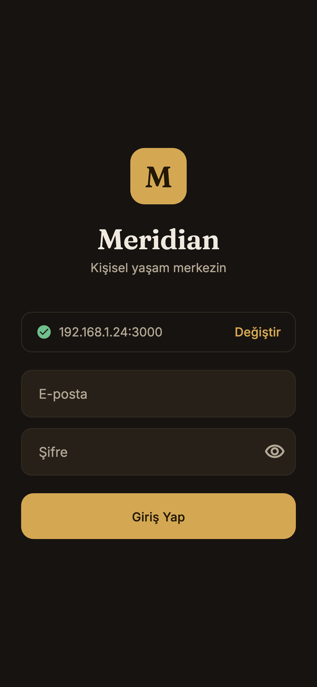
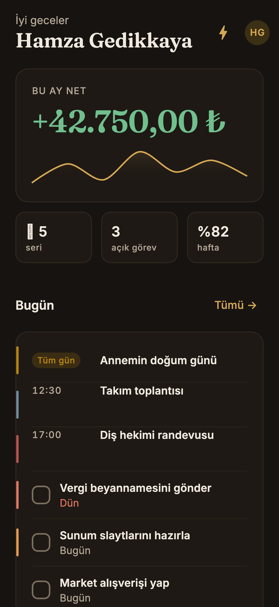
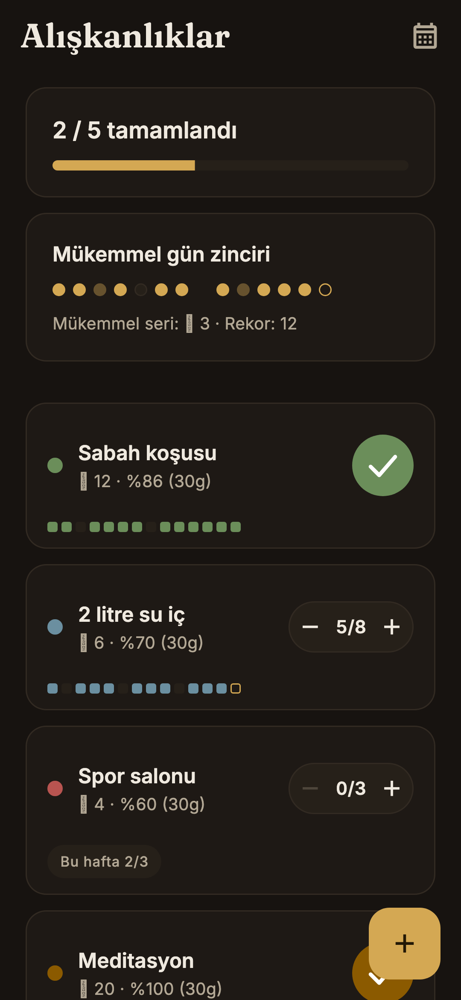
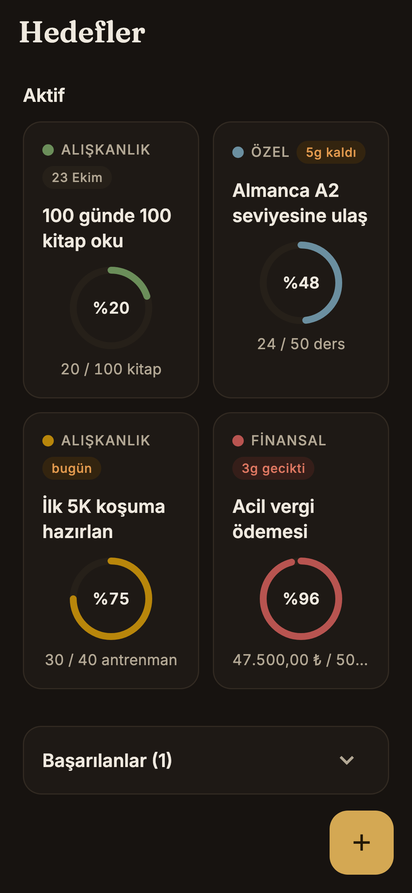
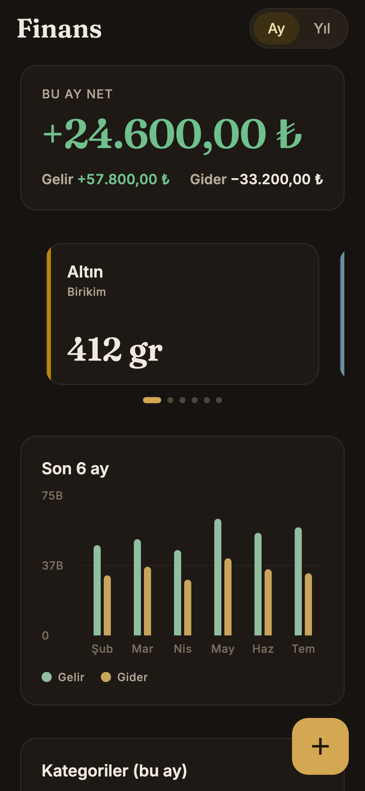
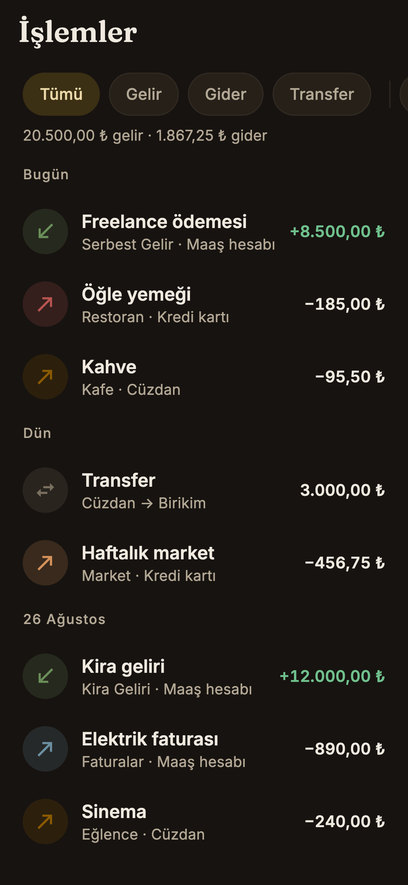
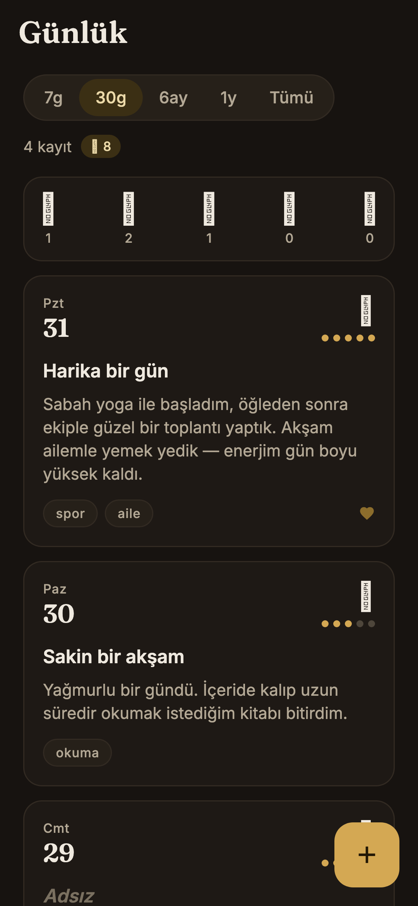
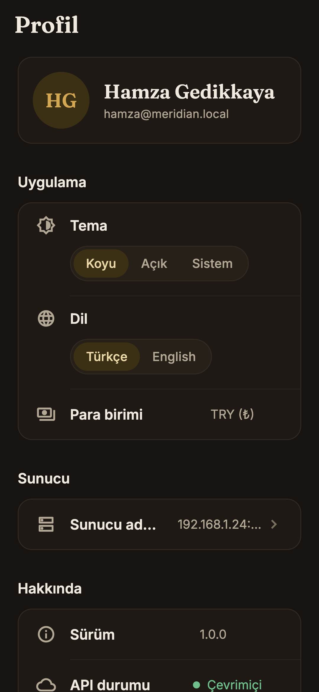

<p align="center"><sub><a href="README.md">English</a> · <b>Türkçe</b></sub></p>

<h1 align="center">
  
  &nbsp;Meridian Mobile
</h1>

<p align="center"><i>Hayatınız, mükemmel bir şekilde düzenlenmiş — artık cebinizde.</i></p>

<p align="center">
  
  
  
  
  
  <a href="https://github.com/hamzagedikkaya/meridian"></a>
  <a href="LICENSE"></a>
</p>

<p align="center">
  <a href="#-%C3%B6ne-%C3%A7%C4%B1kanlar">Öne çıkanlar</a> ·
  <a href="#-h%C4%B1zl%C4%B1-ba%C5%9Flang%C4%B1%C3%A7">Hızlı başlangıç</a> ·
  <a href="#-mimari">Mimari</a> ·
  <a href="#-tasar%C4%B1m-sistemi">Tasarım</a> ·
  <a href="#-api-y%C3%BCzeyi">API</a> ·
  <a href="#-testler">Testler</a>
</p>

---

Meridian Mobile, [**Meridian**](https://github.com/hamzagedikkaya/meridian)'ın — kendi makinende çalışan, local-first kişisel "yaşam OS"unun — Flutter istemcisi. *Senin* Rails sunucunla *senin* Wi-Fi'ın üzerinden konuşur: bulut kiracılığı yok, üçüncü parti analitik yok, açılacak hesap yok. Uygulamayı `http://192.168.1.20:3000` adresine yönlendir, giriş yap; paran, alışkanlıkların, hedeflerin ve günlüğün telefonunda.

Android öncelikli, varsayılanı koyu tema ve tam çift dilli — her ekran **Türkçe ve İngilizce** konuşuyor, uygulama içinden değiştiriliyor ve hesabında saklanıyor. Her sayı tam sayı kuruş değerinden, o para biriminin doğru alt birimiyle ve dilin beklediği yazımla basılır.

<p align="center">
  
  
  
  
</p>

<p align="center"><sub>Golden test harness'ının gerçek çıktıları — gömülü fontlar, gerçekçi fixture'lar, telefon ölçüleri (360×780 @3x). <a href="#-testler">Testler bölümüne bak</a>.</sub></p>

## ✨ Öne Çıkanlar

Beş sekme, her biri bir alan — üstüne push edilen profil katmanı.

### ☀️ Bugün — günün tamamı tek kaydırmada
Saate göre selamlama, altında ayın neti Fraunces display rakamlarıyla ve 7 günlük harcama sparkline'ı. Üç istatistik çipi (seri · açık görev · haftalık alışkanlık oranı), her biri kendi sekmesine derin bağlantı. Bugünün etkinlikleri ve son tarihi bugün olan görevler aynı kartta — öncelik 3dp'lik sessiz bir kenar çubuğu, gecikmiş tarihler kırmızı, görev işaretleme anında animasyonlanır, altı saniye boyunca **Geri al** sunar (ekran okuyucu açıkken kapatılana kadar) ve sonra sunucuyla uzlaşır (işaretli bir satıra yeniden dokunmak görevi yeniden açar). Altında bugünün alışkanlıkları dokun-tamamla halkalarıyla — günde birkaç kez yapılan günlük bir alışkanlık her dokunuşta bir artar (`/home` bir alışkanlığın ne sıklıkla tekrarlandığını söylemez; bunun için Alışkanlıklar listesi bir kez okunur, o zamana kadar her halka yalnızca yapıldı ya da yapılmadı der); uzun basmak (ya da dolu bir halkaya dokunmak) günün kaydını açar, oradan geri azaltılır ya da sıfırlanır — sonra ilk üç hedef pace'li ilerleme çubuklarıyla. ⚡ ikonu **hızlı kayıt**'ı açar — tek alan; `-250 kahve` / `+1500 maaş` işleme, `alışkanlık: koşu` / `habit: koşu` alışkanlık log'una, geri kalan her şey göreve gider. Onay neyin kaydedildiğini söyler (`Harcama eklendi · −250,00 ₺ · kahve`); bir gün adı geçen satır (`yarın 15:00 dişçi`) hiçbir şey kaydetmez ve bunu söyler, onun yerine görev olarak kaydetmeyi önerir; bir ret de bir sonraki adımıyla birlikte sayfada kalır — para satırının ihtiyaç duyduğu hesabı ya da `alışkanlık:` satırının adını verdiği alışkanlığı oluştur. Yanıtı hiç gelmeyen bir kayıt kaydedilmiş olabilir; sayfa, onu iki kez kaydedebilecek körlemesine bir yeniden deneme önermek yerine bunu söyler. Gecikmiş görevler sekmenin kendisinde kırmızı sayı rozeti olarak görünür.

### 💰 Finans — tablo dosyası olmadan para
Ay/Yıl segmentli hero, gelir–gider kırılımıyla. Hesaplar kayıp-oturan bir kart karuseli; her biri kendi para biriminde (`412 gr` gram altın için, `1.234,56 ₺` lira için) ve hesap detayına Hero geçişiyle. Ardından altı aylık gruplu gelir/gider bar grafiği, dokununca alt kategorilere inen kategori donut'ı ve **pace tick**'li bütçe satırları — bugün nerede *olman gerektiğini* gösteren dikey işaret — bütçeyi geçme hızındaysan üstüne ay sonu tahmini satırı. Ekranı yaklaşan abonelikler ve son işlemler kapatır.

**İşlemler** tam akış: yapışkan filtre çipleri (tür · hesap · kategori · tarih aralığı), güne göre gruplanmış başlıklar (`Bugün` / `Dün` / `12 Temmuz`), sonsuz kaydırma, onaylı sola-kaydır-sil ve düzenle/sil içeren detay sayfası. İşlem oluşturma **tutar öncelikli**: özel 4×3 tuş takımıyla sürülen kocaman serif rakam, sonra hesap, kategori, tarih, açıklama — gram altın hesaplarında ondalık tuşu gizli.

### 🔥 Alışkanlıklar — anlamı olan seriler
"2 / 5 tamamlandı" çubuğu, 30 noktalı **mükemmel gün zinciri**, sonra alışkanlık başına bir kart: seri, 30 günlük tamamlanma oranı, 14 günlük zincir şeridi ve ya dokunmalı halka ya da `− 5/8 +` sayaç pili (günde birkaç kez yapılan günlük bir alışkanlık). Haftalık ya da aylık bir alışkanlık dönemine *gün* sayar; bu yüzden günü bir halkadır, pili haftayı ya da ayı gösterir. Her dokunuş, tersine çevirmek yerine ekranda gördüğü sayıyı gönderir; böylece güncel olmayan bir ekran alışkanlığı yanlış yöne çeviremez. İşaretlemeler iyimser uygulanır, sunucu reddederse nedenini söyleyen bir snackbar'la geri alınır — bu arada web'de arşivlenmiş bir alışkanlık ise her dokunuşta reddedilmek yerine listelerden düşer. Günün son alışkanlığını tamamlamak uygulamanın tek konfetisini tetikler — 12 el-boyaması parçacık, bir kez. Alışkanlık detayı 84 günlük ısı haritası ve arşivleme ekler.

### 🎯 Hedefler — görülebilir ilerleme
İki kolonlu kartlar; animasyonlu ilerleme halkaları, tür üst-başlığı (`FİNANSAL` / `ALIŞKANLIK` / `ÖZEL`) ve renk kodlu son tarih rozetleri (`3g gecikti`, `bugün`, `5g kaldı`). Başarılan hedefler kendi bölümünde katlanır. Detay, halkayı Hero olarak uçurur ve türe uygun paneli gösterir: özel hedeflerde `−10 −1 +1 +10` stepper'ı, alışkanlığa bağlı olanlarda bağlı seri ve gün sayısı, finansal olanlarda bakiyeden yeniden hesaplama.

### 📓 Günlük — yazmak için sakin bir yer
Aralık pili (7g / 30g / 6ay / 1y / Tümü), **dokunarak filtreleyebildiğin** mood dağılımı şeridi, sonra Day One tadında kayıt kartları: Fraunces tarih bloğu, mood emojisi, beş noktayla enerji, etiket pilleri ve minnet işareti. Detay sunucunun zengin metnini render eder. Editör mood check-in'iyle açılır, gövdeye otomatik odaklanır ve 5 saniyede bir taslağı kaydeder.

### 👤 Profil — senin ve sunucunun
Tema (koyu / açık / sistem), **dil (Türkçe / English)**, para birimi, canlı API durumu, uygulama sürümü — ve `/health`'i pingleyip `✓ Bağlandı · Meridian v1.0.0 · 38 ms` raporlayan ayrı bir **sunucu sayfası**. Ulaşılamayan bir adresi kaydetmek onay ister. Çıkış, token'ı ve hesap durumunu siler; sunucu adresi, dil ve tema kalır, böylece giriş ekranı hâlâ senin ayarlarınla açılır.

<p align="center">
  
  
  
  
</p>

<p align="center"><sub>Finans · İşlemler · Günlük · Profil</sub></p>

### Her ekranda geçerli davranışlar
| | |
|---|---|
| **Baştan sona çift dil** | İki tipli metin sınıfı (`lib/l10n/`), analyzer'ın zorunlu tuttuğu soyut bir sözleşme ve Profil'de uygulamayı anında yeniden çizen bir anahtar. Seçim hem cihazda saklanır hem hesaba yazılır; web uygulaması ve yeni kurulum onu izler. Varsayılan Türkçe; ilk açılışta telefonun dili ikisinden biriyse o kullanılır. |
| **Dile uygun sayılar** | Türkçede `%82`, İngilizcede `82%`. `1.234,56 ₺` ile `1,234.56 ₺`. Grafik ekseninde `75B` ile `75K`. `27 Ağustos` ile `August 27`. Tek bir `Intl.defaultLocale`, yerelleştirme delegate'i tarafından senkron tutulur. |
| **Çevrimdışı dürüstlüğü** | Başarısız yenileme, son iyi veriyi ekranda tutar: hairline bir banner — `Çevrimdışı · son güncelleme 12:40` ve tekrar dene. Tam ekran hata durumu yalnızca gösterilecek hiçbir şey yoksa çıkar. |
| **İyimser yazmalar** | İşaretleme, sayaç ve silme önce arayüzü günceller, sonra uzlaşır; hata olursa snackbar'la geri alınır. |
| **Spinner değil skeleton** | Her ekranın kendi geometrisini taklit eden bir kemik düzeni var, içeriğe cross-fade ile geçer. Hiçbir yerde bloklayan dialog yok. |
| **Para tek bir yerde** | Tam sayı `*_cents` + para birimi başına `subunit_to_unit`, tek bir fonksiyonda biçimlenir. Gram altının (`GAU`) alt birimi 1 olduğu için `412 gr` basar — asla `4,12` değil. |
| **Sadece renk değil, işaret** | Gelir yeşil `+`, gider varsayılan mürekkep renginde `−`. Asla yalnızca renkle değil — kırmızı bir duvar tedirgin eder ve renk körlüğünde renk tek başına çalışmaz. |
| **Hata bir sebep taşır, cümle değil** | API katmanı tipli bir `ApiErrorKind` fırlatır; arayüz onu aktif dildeki metne çevirir. Sunucu doğrulama mesajları olduğu gibi gösterilir — Rails onları kullanıcı diline göre zaten yerelleştiriyor. |
| **Haptik** | Dört seviyeli harita: seçimde tick, başarıda hafif, kutlamada orta, yıkıcı onayda ağır. Web'de sessizce devre dışı. |

## 🧰 Teknoloji

| Katman | Seçim |
|---|---|
| Framework | Flutter 3.44 · Dart 3.12 (Material 3) |
| Durum | `flutter_riverpod` ^3.3.2 — codegen yok; son iyi değeri koruyan `AsyncValue` |
| Yönlendirme | `go_router` ^17.3.0 — `StatefulShellRoute.indexedStack`, 5 branch, kök seviyede modal route'lar |
| Ağ | `dio` ^5.10.0 — Bearer interceptor, `401` → çıkış, tüm hatalar tek `ApiException`a normalize |
| Yerelleştirme | tipli metin sınıfları + bir `LocalizationsDelegate` (`.arb` yok, codegen yok) · `flutter_localizations` |
| Depolama | `flutter_secure_storage` ^10.3.1 (sunucusuna bağlı token, günlük taslakları) · `shared_preferences` ^2.5.5 (sunucu adresi, dil, tema) |
| Grafik | `fl_chart` ^1.2.0 — donut, sparkline, gruplu altı ay barları |
| Hareket | `animations` ^2.2.0 (fade-through) · `flutter_animate` ^4.5.2 (yalnızca giriş stagger'ları) |
| Yükleme | `skeletonizer` ^2.1.3 |
| Zengin metin | `flutter_widget_from_html_core` ^0.17.2 — günlük `body_html` |
| Biçimleme | `intl` ^0.20.2 — dile göre para, tarih ve ay adları |
| Tipografi | Fraunces + Inter, `assets/fonts/` altında `.ttf` olarak gömülü — çalışma anında font indirme yok |
| Kalite | `flutter_lints` ^6.0.0 · `flutter_test` · `matchesGoldenFile` |

## 🚀 Hızlı Başlangıç

**Gereksinimler** — Flutter 3.44+ stable (Dart 3.12+), cihaz build'i için API 26+ Android SDK ve `/api/v1`'i sunan çalışan bir [Meridian](https://github.com/hamzagedikkaya/meridian) sunucusu.

```bash
git clone https://github.com/hamzagedikkaya/meridian-mobile.git
cd meridian-mobile
flutter pub get
flutter run                 # Android cihaz veya emülatör
```

Tarayıcıda düzen/veri önizlemesi için:

```bash
flutter run -d chrome --web-browser-flag=--disable-web-security
```

> Meridian sunucusunda CORS middleware'i yok, bu yüzden tarayıcı önizlemesi bu flag'i (ya da yalnızca geliştirme için bir `rack-cors`) gerektirir. Native build'ler etkilenmez.

### Sunucuna bağlanmak

Giriş ekranındaki adres alanı makul bir varsayılanla dolar ve son seçimini hatırlar:

| Nerede çalıştırıyorsan | Ön-dolu adres |
|---|---|
| Chrome (web önizleme) | `http://localhost:3000` |
| Android emülatör | `http://10.0.2.2:3000` |
| Fiziksel cihaz | son kullanılan — makinenin LAN IP'sini gir, örn. `http://192.168.1.20:3000` |

Adresi yaz, ✓ işaretini bekle, sonra herhangi bir Meridian kullanıcısıyla giriş yap — sunucunun seed'i `demo@meridian.local` hesabını oluşturur; şifresini seed sırasında sen belirlersin. Health ping'i başarılı olana kadar kimlik bölümü soluk kalır; böylece yanlış bir adres asla yanlış şifre gibi görünmez.

LAN sunucusuna cleartext `http://` erişimi **ana** manifest'teki `network_security_config.xml` ile açık; böylece hem debug hem release build çıplak bir LAN IP'sine ulaşır. Bu bilinçli bir ödünleşim: aynı ağdaki herkes trafiği, bearer token dahil, okuyabilir. Kapatmak için sunucuyu HTTPS arkasına al (yerel CA'lı bir reverse proxy ya da Tailscale) ve `cleartextTrafficPermitted` değerini `false` yap.

Release build'ler yalnızca senin anahtarınla imzalanır: `keytool` ile bir anahtar oluştur, sonra `storeFile`, `storePassword`, `keyAlias` ve `keyPassword` değerlerini gitignore'daki `android/key.properties` dosyasına yaz. Bu dosya yoksa release APK imzasız kalır ve kurulmaz — debug keystore'una asla geri düşmez.

### Günlük komutlar

```bash
flutter analyze                                          # statik analiz — şu an temiz
flutter test                                             # unit + widget kümeleri
flutter test --run-skipped test/golden                   # ekran görüntülerini karşılaştır
flutter test --run-skipped --update-goldens test/golden  # iki seti de yenile
flutter build apk --release                              # sideload'lanabilir APK
```

## 🧱 Mimari

```
lib/
├─ main.dart          ProviderScope + MaterialApp.router, tüm intl locale'leri yüklü
├─ core/              api.dart          dio factory, Bearer interceptor, ApiErrorKind
│                     session.dart      token deposu, sunucu adresi, oturum makinesi, /health
│                     locale_mode.dart  arayüz dili: cihaz seçimi → hesap → telefon → tr
│                     theme_mode.dart   koyu/açık/sistem, aynı sırayla çözülür
│                     formats.dart      para, tarih, ondalık — yalnızca değer biçimleme
│                     haptics.dart      dört seviyeli haptik haritası
├─ l10n/              app_l10n.dart     soyut sözleşme + delegate + context.l10n
│                     app_l10n_tr.dart · app_l10n_en.dart   dil başına bir sınıf
├─ models/            değişmez modeller: hoşgörülü fromJson + saf iyimser yamalar — alan başına bir dosya
├─ data/              repository.dart   endpoint başına bir async metot; yazmalar neyi değiştirdiğini söyler
│                     providers.dart    Riverpod provider'ları → AsyncValue<Fetched<T>>
│                     sync.dart         değişiklik → önbellekteki ekranlar tablosu, DataSync, yenileme yardımcıları
│                     actions.dart      geri alınabilen iyimser alışkanlık / görev yazmaları (net durum)
│                     current_day.dart  hesabın bugünü, hesabın gece yarısında devrilir
├─ theme/             app_colors.dart   Noktürn token'ları ThemeExtension olarak (koyu + açık)
│                     app_typography.dart · app_theme.dart
├─ router/            app_router.dart   shell branch'leri, oturum yönlendirmesi, fade-through
└─ ui/
   ├─ widgets/        yirmi dört paylaşılan parça: NokturnCard, NokturnRow, MoneyText,
   │                  ProgressRing, PacedProgressBar, AmountKeypad, PickerSheet…
   └─ screens/        today · finance · habits · goals · journal · profile · shell
                      (+ login, splash) — her biri kendi widgets/ klasörüyle
```

Rotalar klasörleri birebir yansıtır — `/today`, `/finance`, `/finance/transactions`, `/habits`, `/goals/:id`, `/journal/:id`, `/profile/server` — böylece kod tek dilde kalırken arayüz iki dil konuşur.

**Yerelleştirme.** `AppL10n`, her metin için bir üye taşıyan soyut bir sınıf; `AppL10nTr` ve `AppL10nEn` onu implemente eder. Yalnızca tek dilde yazılmış bir metin derlenmez — bütün mesele bu: bir boşluğu sessizce gizleyecek çalışma-anı fallback'i yok. API değerleri (`mood`, `account_type`, `frequency`) saklanan metin yerine küçük `switch` metotlarıyla eşlenir; delegate `Intl.defaultLocale`'i senkron tutar, böylece `core/formats.dart` sayı ve tarihleri ağaç boyunca locale taşımadan aktif dile göre biçimler.

**Okuma yolu.** Ekran bir provider'ı izler, o repository'ye sorar, o da dio'yu çağırır. Provider'lar `Fetched<T>` döner — veri artı geldiği an — ve Riverpod 3 önceki değeri hem yeniden çekme sırasında hem de başarısız bir yenilemede korur. Ekranın ne çizeceğine her ekranda aynı olan tek bir kural karar verir: `AsyncScreenState` (`ui/widgets/sync_hint.dart`). Ekrandaki veri, yenisi yüklenirken asla değiştirilmez (`isRefetching` yalnızca ince bir ilerleme çizgisi ekler); iskelet yalnızca `isFirstLoad` için, henüz hiçbir şey gösterilmemişken; tam hata görünümü yalnızca `hasFailed` için, yükleme başarısız olmuşken ve gösterilecek bir şey yokken; çevrimdışı banner'ı ise son iyi verinin zamanıyla yalnızca `refreshFailed` için — ekranda veri var ve son yenilemesi başarısız olmuş. Tek hızlı yeniden deneme her çekmenin içinde çalışır (`data/providers.dart` içindeki `retried`; okuma modellerinde Riverpod'un kendi yeniden denemesi kapalı), bu yüzden ekran yalnızca bir çekmenin sonucunu görür: denemenin düzelttiği anlık bir kesinti banner'ı hiç yakıp söndürmez, bir kez gösterilen hata da — banner ya da hata görünümü — yeniden başarısız olan her denemede yerinde kalır, ta ki bir çekme başarıyla gelene dek. Önbellek oturum başına ve bellekte; diske hiçbir şey yazılmıyor.

**Yazma yolu.** Her yazma repository'den geçer; repository neyi değiştirdiğini — işlemler, alışkanlık işaretlemeleri, hedefler, görevler, günlük kayıtları — `DataSync`'e (`data/sync.dart`) bildirir. Oradaki tek tablo, her değişiklik türünü sunucu verisi ona bağlı olan önbellekteki her ekrana eşler: `/home` işlemleri, alışkanlık kayıtlarını, görevleri ve hedefleri bir araya toplar, finans paneli işlemleri toplar, hedefler bakiyelerden ve işaretlemelerden yeniden hesaplanır. `/home` her hedefin ilerlemesini sunucunun hedefler en son okunduğunda kaydettiği haliyle gösterir; bu yüzden ikisi birden yenilenecekse hedefler `/home` ile birlikte okunur — hiçbiri ötekini beklemez — ve yeniden hesaplama `/home`'un gösterdiği bir hedefi kıpırdattıysa `/home` bir kez daha istenir: bir işaretleme ya da işlem Bugün'deki hedef çubuklarını da kıpırdatır. Yalnızca o ekranlar yeniden çekilir — görünenler hemen, gizli sekmeler gösterildikleri anda — böylece hiçbir ekran neyin yenileneceğine kendi karar vermez ve formu sunucu yanıt vermeden kapatılan bir yazma da her şeyi yeniler. Bir alışkanlığı ya da görevi işaretlemek önce önbelleği yamar; Bugün ve Alışkanlıklar aynı karede değişir, sunucu reddederse geri alınır. Dokunuşun sonucu bir kez, ekranda görünenden hesaplanır; hem yama hem istek bu sonucu tersine çevirmek yerine *açıkça* söyler — bir alışkanlık gününün sayısı (`PUT /habits/:id/logs/:date`), bir görevin yapılıp yapılmadığı (`done: true|false`): dokunuşu zaten içeren bir yeniden çekme olduğu gibi kalır, yeniden denenen bir istek aynı duruma varır ve güncel olmayan bir ekran bir alışkanlığı yanlışlıkla çeviremez ya da bir görevi yeniden açamaz. Yama, sunucunun yanıtından sonra yola çıkmış bir yeniden çekme gelene kadar bekler: o sırada yolda olan bir yeniden çekme, işaret üzerine uygulanmış olarak gösterilir — getirdiği yenilik korunur, işaret de geri kaymaz — ve aynı alışkanlığa yapılan hızlı dokunuşlar düşürülmek yerine sırayla gönderilir. Dokunuş ekranın geri kalanını olduğu gibi bırakır — yolda olan bir yeniden çekme ilerleme çizgisini, başarısız bir yenileme banner'ını korur — ve listenin gününden başka bir güne ait bir yanıt (gece yarısından hemen önce gönderilmiş bir işaretleme) listeye katılmaz.

**Güncel kalmak.** Aynı yer uygulamaya geri dönüldüğünde (30 sn'den uzun ayrılıktan sonra), açık sekmeye yeniden dokunulduğunda (sekme ayrıca en üste kayar), hesabın gece yarısında ve verisi bir dakikadan eski bir ekran yeniden gösterildiğinde de yeniler — web'de yapılan düzenlemeler aşağı çekmeden görünür. Kaydının başka yerde silindiğini (`404`) gören bir detay ekranı bunu söyler — yeniden denemesi ancak bir `404` daha getirebilecek çevrimdışı banner'ını göstermez — ve o kaydı hâlâ gösteren her listeyi de yeniden çektirir; geri dönünce hayalet bir satıra düşülmez. Yenileme ekranı hiç boşaltmaz: mevcut veri ince bir ilerleme çizgisinin altında yerinde kalır, iskelet yalnızca henüz hiçbir şey gösterilmemişken görünür, hata görünümü (eskimiş veride de banner) yeniden deneme sürerken yerinde kalır, hata da saniyeler içinde görünür (her çekmede yalnızca kopan bağlantı ya da 5xx için tek bir hızlı yeniden deneme; Riverpod'un varsayılan 40–90 sn'lik sessiz denemeleri asla). İşlemler akışı, değişmez bir `TxFilters` kaydıyla anahtarlanan bir `AsyncNotifier` — bu yüzden akış ve hesap detayı durum paylaşmadan yan yana sayfalayabilir; yenileme ilk sayfaları yeniden yükler — en fazla beşini, 250 satır — ve onların ötesinde yüklenmiş satırları korur; böylece uzun bir kaydırma boyunu ve yerini korur. Uygulamada yapılan bir düzenleme ya da silme, satırı nerede olursa olsun ona uygulanır — satırı başka bir güne taşıyan bir düzenleme, yeniden yüklenen sayfaların ötesinde de olsa onu oraya taşır; sonsuz kaydırma da ekrandaki satırlardan devam eder, hiçbir satırı atlamaz.

**Saat dilimleri.** Sunucu günleri hesabın saat diliminde (`user.timezone`) sayar: Bugün'ün alışkanlıkları, bugün son tarihli görevler, ay toplamları, günlüğün aralıkları. Telefonun kendi dilimi farklı olabilir — bir yurt dışı seyahati, UTC'ye ayarlı bir telefon — bu yüzden uygulama `/me`'nin bildirdiği farka göre hesabın dilimini izler: "bugün", gece yarısı yenilemesi, `Bugün`/`Dün` etiketleri ve yeni bir kaydın varsayılan tarihi hesabınkidir; sunucudan gelen her tarih-saat hesabın duvar saatiyle gösterilir (hesabın farkıyla gelir; uygulama telefonun dilimine çevirmek yerine tarihi ve saati yazıldığı gibi okur). "Bugün" için yapılan bir yazma, telefonun değil sunucunun bildirdiği tarihi gönderir. İki dilim farklı olduğunda Bugün, günlerin ve saatlerin hangi dilime göre gösterildiğini söyler (kapatılabilir), Profil de ikisini birden gösterir. Yalnızca selamlama telefonun saatini izler — kayıtlarla değil, kişiyle ilgilidir.

**Oturum.** Splash kapısı token'ı okur, iyimser yönlendirir ve arka planda `/me`'yi yoklar; herhangi bir yerden gelen `401` dio interceptor'ını tetikler, token'ı siler ve bir uyarıyla girişe atar. `go_router` yönlendirmesini üç durumlu bir oturum makinesi sürer (`unknown` → `loggedOut` / `loggedIn`), yani nereye düşeceğine karar veren tam olarak tek bir yer var.

## 🎨 Tasarım Sistemi

Görsel dil **Noktürn** — sıcak-koyu özel bankacılık ile Day One'ın kesişimi. Derin espresso siyahları (asla saf `#000` değil), vurgu ve birincil aksiyonlara ayrılmış tek bir disiplinli altın, hero sayılar için serif display tipografi. Her token ve ekran dahil tam şartname: [`docs/design.md`](docs/design.md).

<p align="center">
  
  
  
  
  
  
  
</p>

- **Renk** — tema başına 26 isimli token, `ThemeExtension` olarak sunulur ve `context.nok` ile okunur. Altın asla "iyi" ya da "kötü" demez; "senin" der. Yeşil ve kırmızı sıkı sıkıya semantik kalır, altını değerli tutan da bu.
- **Yükseklik** — gölge değil, yüzey basamakları ve 1dp hairline'lar. `bg` → `surface1` (kartlar) → `surface2` (nav, input, çip) → `surface3` (sheet, dialog).
- **Tipografi** — display ve başlıklarda Fraunces 600, geri kalan her şeyde Inter. Tüm tutarlar tabular figür kullanır; iki dilde de kolonlar oynamaz.
- **Hareket** — varsayılan 350ms `easeOutCubic`, spring yok. Sekmeler arası fade-through, oluştur/düzenle modalleri için 400ms slide-up, tüm uygulamada tam olarak iki Hero uçuşu ve bilinçli tek bir overshoot: işaretleme pop'u. Hero sayılar ilk yüklemede sayarak artar, yenilemede cross-fade olur — sayılarını yeniden animasyonlayan bir yenileme, neyin değiştiği konusunda yalan söylüyor demektir.
- **Açık tema** — sıcak kâğıt üzerine tam bir ikinci palet; AA kontrastı tutması için altın `#96731D`'ye koyulaştırılmış.

## 🔌 API Yüzeyi

Tüm endpoint'ler `/api/v1` altında, `Authorization: Bearer <api_token>` ile kimliklenir. Para her zaman tam sayı `*_cents` olarak, para biriminin `subunit_to_unit` değeriyle birlikte gider.

| Endpoint | Neyi besler |
|---|---|
| `GET /health` | giriş ping'i ve sunucu ayarları testi (kimliksiz; gecikmeyi istemci kendi ölçer) |
| `POST /session` · `GET /me` | giriş, token geçerlilik yoklaması, görünen ad ve tercihler |
| `PATCH /me` | telefonda seçilen dil ve tema, hesaba yazılır |
| `GET /home` | tüm Bugün ekranı tek istekte |
| `GET /finance/dashboard` · `GET /accounts` | Finans: net, altı ay serisi, kategori pastası, bütçeler, abonelikler, son işlemler |
| `GET/POST/PATCH/DELETE /transactions` · `GET /finance_categories` | işlem akışı, filtreler, oluştur/düzenle/sil |
| `GET /habits` · `PUT /habits/:id/logs/:date` · `archive` | alışkanlık kartları, zincirler, mükemmel gün şeridi, açık bir sayıya ayarlanan iyimser işaretlemeler |
| `GET /goals` · `PATCH /goals/:id/update_progress` · `recalculate` | hedef kartları, halkalar, türe özgü aksiyonlar |
| `GET/POST/PATCH/DELETE /journal_entries` | günlük listesi, detay (`body_html`), editör |
| `GET /todos` · `PATCH /todos/:id/toggle` (`done`) · `GET /events` | Bugün'ün gün kartı ve görev sayfası |
| `POST /quick_captures` | ⚡ tek alanlı yönlendirici (bir satırı görev olarak kaydetmek için `as: "todo"`) |

Hata sözleşmesi: her ret sabit bir `code` taşır — `401 unauthorized` → çıkış · `404 not_found` · alan başına `details` ile `422 validation_failed` ya da adı konmuş bir ret (`no_account`, `unknown_habit`, `future_date`, `reason`'ıyla `invalid_amount`, …). Uygulama her kodu aktif dilde kendisi söyler, bir doğrulama ayrıntısını da ilgili alanın altında — sunucunun ham cümlesini asla. Başarısız bir işlem, sunucu nedenini söylediyse nedenini, söylemediyse neyin olmadığını söyler; ağ hatası neye bakılacağını söyler: *"Sunucuya ulaşılamıyor — aynı Wi-Fi ağında olduğundan emin ol."*

## 🧪 Testler

```bash
flutter analyze                          # sorun yok
flutter test                             # 348 test, golden kümesi atlanır
flutter test --run-skipped test/golden   # 16 ekran görüntüsü, iki dilde
```

| Test kümesi | Kapsadığı |
|---|---|
| [`test/models_test.dart`](test/models_test.dart), [`test/models/`](test/models/) | her payload şekli → model; null'lar, zarflar, çoklu para birimli hesaplar ve kısmi alışkanlık gününün tamsayı sayaçları dahil; iyimser yamalar sunucunun bir günün sayısı için sakladığını birebir izler; tarih-saatler hesabın duvar saatiyle okunur |
| [`test/data/`](test/data/) | sahte bir API'ye karşı yenileme mimarisi: her yazma türü yalnızca verisini değiştirdiği ekranları yeniden çeker; başarısız yazmalar, süren yazmalar, bir yeniden çekme yoldayken gelen dokunuşlar, hesabın gece yarısı (yaz saati geçişlerinde ve telefon hesaptan başka bir dilimdeyken de; ikisi de başka saat dilimlerinde ikinci bir Dart VM'de denetlenir), geri dönüş, net durumlu yazmalar, hızlı kaydın yanıtları ve listeyi kıpırdatmadan yenilemeden sağ çıkan sayfalama |
| [`test/core/`](test/core/) | hata biçimi: her `code` iki dilde, alan başına doğrulama ayrıntıları ve başarısız bir işlemin ne zaman nedenini söylediği |
| [`test/formats_test.dart`](test/formats_test.dart) | para ve tarih biçimleme: TRY, USD ve gram altının alt-birim-1 kuralı |
| [`test/l10n_test.dart`](test/l10n_test.dart) | yerelleştirme katmanı: locale çözümü, yüzde işaretinin yeri, dile göre gruplama ve ay sırası, göreli günler, API değer eşlemeleri ve iki dilde hata sözleşmesi |
| [`test/screens/`](test/screens/), [`test/widgets/`](test/widgets/) | ekran başına widget smoke testleri, provider override'larıyla — dolu *ve* boş durumlar, artı uygulamayı çalışırken İngilizceye geçirme; sekmeye yeniden dokunma, Bugün'e geri geçiş, uygulamaya geri dönüş ve asla geri dönmeyen işaretlemeler; sekmelerin üzerine açılan bir sayfadaki hero'lar; kaydı başka yerde silinmiş detay ekranları; gerçek bir okuma modeline ve onun hızlı yeniden denemesine karşı tek iskelet / veri / hata görünümü kuralı; hızlı kaydın yanıtları (ne kaydedildiği, hiçbir şey kaydetmeyen satır, bir sonraki adımıyla retler); Bugün'deki geri alma ve alışkanlığın gün kaydı; saat dilimi uyarısı; yenilemede yerini koruyan uzun bir akış |
| [`test/golden/`](test/golden/) | sekiz ekranın tamamı 360×780 @3x'te **iki dilde**, gerçek gömülü fontlar ve çevrilmiş fixture'larla |

Golden kümesi bir **görsel inceleme aracı**, geçti/kaldı kapısı değil. Fixture'ları "şimdi"ye göreli (`Bugün`, `Dün`, `5g kaldı`) — ekranlar canlı bir telefon gibi görünsün diye; bu da saat ilerledikçe görüntülerin kaymasına yol açar. Bu yüzden `golden` etiketli ve varsayılan koşuda atlanıyor (`dart_test.yaml`), böylece `flutter test` deterministik kalıyor; bilinçli olarak `--run-skipped` ile çalıştır, `--update-goldens` ile tazele. Verisi de arayüzle birlikte çevrilir; `images/en/` bir İngiliz kullanıcının telefonu gibi okunur, Türkçe içeriğin üstüne geçirilmiş İngilizce bir kabuk gibi değil. Emoji glyph'leri test renderer'ında kutuya düşer — cihazda normal görünürler.

## 🗺 Yol Haritası

Tamamlanan: beş sekme, uygulama içi anahtarla Türkçe/İngilizce arayüz, işlem oluştur/düzenle/sil, alışkanlık ve hedef yazmaları, günlük editörü, hızlı kayıt, profil ve sunucu ayarları.

Henüz yok:

- **Hesap oluşturma/düzenleme** — Finans ekranı "yakında" diyor ve gerçekten öyle
- **Ayrı Görevler ve Ajanda sayfaları** — görevler Bugün'ün sayfasından okunup işaretleniyor, etkinlikler salt okunur
- **Yalnızca web'de olan modüller** — takvim, insights, haftalık review, yedekler ve global arama şimdilik Rails uygulamasında
- **Release rötuşları** — launcher ikonu ve splash hâlâ Flutter varsayılanı, CI workflow'u yok
- **Disk önbelleği** — son iyi veri oturum başına bellekte; sunucusuz soğuk açılış boş durumu gösterir

## 📄 Lisans

Meridian Mobile, Meridian projesinin parçasıdır ve sunucuyla aynı koşullarla — [**PolyForm Noncommercial License 1.0.0**](LICENSE) — dağıtılır. Kişisel, akademik ve eğitim amaçlı kullanım serbesttir; ticari kullanım bu lisansla verilmez. Farklı bir anlaşma istiyorsan issue açabilirsin.

---

<p align="center"><sub>Meridian Mobile — hayatınız mükemmel bir şekilde düzenlenmiş, kendi ağınızda.</sub></p>
